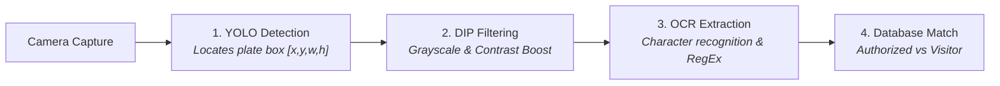

# 🚗 Plakado - Campus License Plate Identifier & Gate Security System

**Plakado** is an automated campus vehicle monitoring and license plate recognition system built using **Flutter**, designed under the **MVC (Model-View-Controller)** architectural pattern. It integrates **Digital Image Processing (DIP)** and **YOLO (You Only Look Once)** object detection concepts with **Optical Character Recognition (OCR)** to identify vehicle plates at school checkpoints.

---

## 🏛️ System Architecture: MVC Pattern

The codebase is organized strictly into Model-View-Controller layers:

```
lib/
├── models/                     # [MODEL] Business entities & database schemas
│   ├── user_profile.dart       # Student, Faculty, Security Guard, Admin profiles
│   ├── vehicle_registration.dart # Registered plate, make, model, color, status
│   ├── scan_log_model.dart     # Gate Entry/Exit timestamps, access status
│   └── visitor_model.dart      # Visitor guest pass records
│
├── views/                      # [VIEW] UI presentation & widgets
│   ├── auth/
│   │   └── login_view.dart     # School Gmail login & quick role-testing presets
│   ├── security/
│   │   ├── security_dashboard_view.dart # Officer dashboard & campus metrics
│   │   ├── plate_scanner_view.dart      # Live ALPR camera with YOLO overlay
│   │   ├── verification_dialog_view.dart # Authorized status vs Visitor prompt
│   │   ├── visitor_registration_view.dart # Unregistered vehicle pass issuer
│   │   ├── gate_logs_view.dart          # Searchable, filterable gate history
│   │   └── registered_vehicles_directory.dart # Campus vehicle directory
│   ├── portal/
│   │   ├── student_faculty_dashboard_view.dart # Student/Faculty registered vehicles
│   │   ├── register_vehicle_view.dart   # Vehicle registration form
│   │   └── digital_gate_pass_view.dart  # QR code & Digital Gate Pass Card
│   └── widgets/
│       ├── plate_display_widget.dart    # Philippine standard plate badge
│       ├── yolo_bounding_box_widget.dart # Viewport overlay with laser animation
│       └── quick_stat_card.dart         # KPI metric card
│
├── controllers/                # [CONTROLLER] State management & business logic
│   ├── auth_controller.dart    # Manages school credentials & role switching
│   ├── scanner_controller.dart # Coordinates YOLO -> DIP -> OCR -> DB verification
│   ├── vehicle_controller.dart # Manages vehicle registration and lookup
│   └── gate_log_controller.dart # Records gate entries/exits and visitor passes
│
├── services/                   # Backend & CV pipelines
│   ├── image_processing_service.dart # DIP algorithms (Grayscale, Contrast, ROI)
│   ├── ocr_recognition_service.dart  # On-device Google ML Kit OCR & fallback
│   └── storage_service.dart          # SharedPreferences persistence + seed data
│
└── utils/
    └── plate_formatter.dart    # Plate normalization, regex, & disambiguation
```

---

## 🔬 Image Processing & ALPR Pipeline

Plakado implements a 4-stage pipeline for Automatic License Plate Recognition:



1. **YOLOv8 Detection (Localization)**:
   - Tracks the exact Region of Interest (ROI) coordinates `[x, y, width, height]` of the license plate on camera.
2. **Digital Image Processing (DIP Enhancement)**:
   - **Grayscale Conversion**: Luminance formula $Y = 0.299R + 0.587G + 0.114B$ reduces color noise.
   - **Dynamic Contrast Normalization**: Enhances character glyphs under harsh sunlight or night lighting.
   - **ROI Cropping**: Crops the plate rectangle from the vehicle frame.
3. **Optical Character Recognition (OCR)**:
   - Uses on-device **Google ML Kit Text Recognition** for real-time mobile inference.
   - Cleans character ambiguities (e.g. `O` vs `0`, `I` vs `1`) and validates using Philippine plate regex patterns (`ABC 1234`, `123 ABC`, `NA 12345`).
4. **Campus Verification & Gate Logging**:
   - Queries registered campus vehicles in real-time.
   - **Authorized**: Logs Student/Faculty entry or exit timestamp with 1 tap.
   - **Unregistered**: Alerts guard and opens the **Visitor Gate Pass** registration form.

---

## 👥 The 2 Unified Applications

### 1. Security Guard Gatekeeper App
* **Live ALPR Scanner**: Real-time camera viewfinder with animated YOLO bounding box.
* **Instant Verification Dialog**:
  * 🟢 **Allowed / Authorized**: Displays Driver Name, Role (Student / Faculty), ID Number, Department, Vehicle Details.
  * 🟡 **Visitor / Unregistered**: Flags unregistered vehicle and prompts 1-tap visitor pass creation.
* **Quick Visitor Pass Registration**: Captures Visitor Name, Contact Number, Purpose (Delivery, Inquiry, Guest), Destination Building, and Pass Number.
* **Live Campus Analytics**: Real-time counters for Total Vehicles, Students Inside, Faculty Inside, and Active Visitors.
* **Gate Activity History**: Search and filter by Date, Role, or Plate Number.

### 2. Student & Faculty Vehicle Portal
* **School Gmail Sign-In**: Validates official ISUFST email domain (`@student.isufst.edu.ph` / `@isufst.edu.ph`).
* **Plate Registration**: Registers plate number, vehicle category (4-Wheel Car, Motorcycle, SUV, Van), make/brand, model, and color.
* **Digital Gate Pass**: Generates a high-resolution digital gate pass with an encrypted **QR Code** for quick manual or backup gate checks.
* **Personal Log History**: View personal gate timestamps of when your vehicle entered or left campus.

---

## 🚀 Running the Project

### Prerequisites
* Flutter SDK (3.10+ / 3.38+)
* Dart SDK

### Running on your computer or mobile device:

```bash
# 1. Check connected devices
flutter devices

# 2. Run unit tests
flutter test

# 3. Run on Windows Desktop
flutter run -d windows

# 4. Run on Chrome Web Browser
flutter run -d chrome

# 5. Build Android APK
flutter build apk --release
```

---

## 🔐 ISUFST Authentication & Verification

Plakado is locked to official Iloilo State University of Fisheries Science and Technology credentials:
- **Faculty / Staff**: `*@isufst.edu.ph`
- **Students**: `*@student.isufst.edu.ph`
- **Security Checkpoints**: Instant plate verification and digital gate passes
- **60-Second Email OTP**: Secure, one-time verification codes sent via official campus mail servers

---

## 📧 Starting the Email Relay Service (Optional for Local Development)

To dispatch real verification emails through Google Mail during development:

```bash
# 1. Navigate to the server folder and install dependencies
cd server
npm install

# 2. Configure credentials in server/credentials.json (see credentials.example.json)
# 3. Start the relay
node mail_relay.js
```

